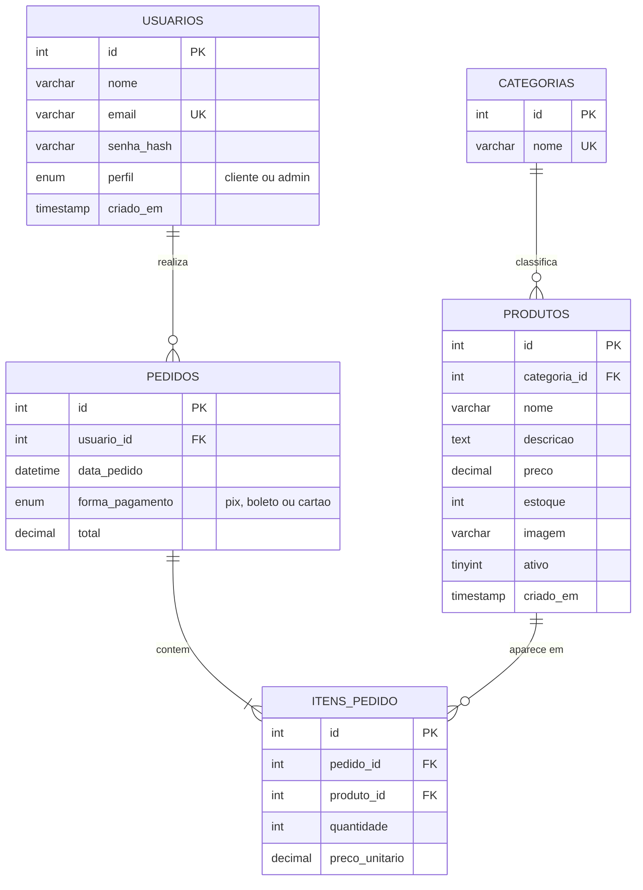

# Fellas Tech

Loja virtual de periféricos e acessórios de tecnologia (teclados, mouses, áudio, monitores e acessórios e placas de video).
Projeto da **Atividade Final do 4º Bimestre** — [Senac Nações Unidas/TI/03].

**Autor:** Joaquim Bernardo Jesus Reis de Araujo

## Funcionalidades

**Cliente**
- Vitrine com produtos vindos do banco, busca por nome/descrição e filtro por categoria
- Página do produto com preço, descrição, imagem e indicador de estoque
- Carrinho na sessão: adicionar, alterar quantidade (limitada ao estoque), remover e totais
- Cadastro, login e logout
- Checkout (somente logado) com pagamento **simulado** (PIX, Boleto ou Cartão), baixa de estoque e histórico de pedidos

**Administrador (`/admin`)**
- Resumo (produtos, esgotados, pedidos, total vendido)
- CRUD de produtos: cadastrar, listar, editar preço/estoque, trocar imagem e desativar/reativar
- Lista de todos os pedidos com itens e total

## Tecnologias

HTML5, CSS3, Bootstrap 5.3, JavaScript, PHP 8+ (Apache/XAMPP), MySQL/MariaDB com PDO e Git.

## Como executar (XAMPP)

**Requisitos:** XAMPP com PHP 8.0 ou superior (Apache + MySQL) e as extensões `pdo_mysql`, `mbstring` e `fileinfo` (já ativas por padrão).

1. Clone o repositório dentro de `htdocs`:
   ```bash
   cd C:\xampp\htdocs
   git clone <URL-DO-REPOSITORIO> fellas-tech
   ```
2. Copie o modelo de configuração e ajuste, se necessário:
   ```bash
   copy .env.example .env
   ```
   Os valores padrão (`root` sem senha) funcionam no XAMPP recém-instalado.
3. Inicie **Apache** e **MySQL** no painel do XAMPP.
4. No phpMyAdmin (`http://localhost/phpmyadmin`), aba **Importar**, envie o arquivo `database/schema.sql`.
   Ele cria o banco `fellas_tech`, as tabelas e os dados de teste.
5. Acesse `http://localhost/fellas-tech/`.

### Variáveis do `.env`

| Variável | Descrição | Exemplo |
|---|---|---|
| `DB_HOST` | Servidor do banco | `localhost` |
| `DB_PORT` | Porta | `3306` |
| `DB_NAME` | Nome do banco | `fellas_tech` |
| `DB_USER` | Usuário | `root` |
| `DB_PASS` | Senha | Fellasenha123 |
| `APP_NAME`, `APP_ENV` | Informativas | `Fellas Tech`, `local` |

O arquivo `.env` real **não vai para o Git** (está no `.gitignore`); só o `.env.example`.

## Contas de teste

| Perfil | E-mail | Senha |
|---|---|---|
| Administrador | `admin@fellastech.test` | `Admin@123` |
| Cliente | `cliente@fellastech.test` | `Cliente@123` |

São credenciais **somente de teste**. No banco, as senhas ficam como hash (bcrypt).

## Estrutura

```
fellas-tech/
├── admin/                 painel administrativo (index, produtos, produto_form, pedidos)
├── assets/
│   ├── css/estilo.css     estilos próprios
│   ├── js/app.js          comportamentos (confirmações, envio único, alertas)
│   └── img/               imagem padrão e fotos dos produtos
├── config/                database.php (PDO) e env.php (leitor do .env)
├── database/schema.sql    criação das tabelas + carga inicial
├── includes/              bootstrap, helpers, auth, carrinho, pedidos, produtos, admin, layout
├── index.php  produto.php  carrinho.php  checkout.php  pedido.php  meus_pedidos.php
├── cadastro.php  login.php  logout.php
└── .env.example  .gitignore  .htaccess
```

## Modelo do banco



- `itens_pedido` resolve a relação N:N entre produtos e pedidos e **congela o preço** (`preco_unitario`) no momento da compra.
- Valores monetários usam `DECIMAL(10,2)`; estoque e quantidades usam inteiros.
- `produtos.ativo` permite desativar sem apagar (a FK com `RESTRICT` protege o histórico de pedidos).

## Segurança

- **Credenciais** em variáveis de ambiente (`.env`, ignorado pelo Git); `.env.example` como modelo; o `.htaccess` bloqueia o acesso ao `.env` pelo navegador.
- **SQL Injection:** somente *prepared statements* (PDO com `ATTR_EMULATE_PREPARES = false`). Nos `IN (...)` entram apenas marcadores `?`.
- **Senhas:** `password_hash()` / `password_verify()`; mensagem de erro única no login e conferência de tempo constante para e-mails inexistentes.
- **Sessão:** cookie `HttpOnly` e `SameSite=Lax`, id regenerado no login/logout, apenas o id do usuário na sessão (perfil conferido no banco a cada requisição).
- **Controle de acesso:** `/admin` exige perfil administrador no servidor (visitante vai ao login, cliente recebe 403); pedidos só podem ser vistos pelo dono ou pelo admin.
- **CSRF:** token em todos os formulários POST (logout só por POST).
- **XSS:** toda saída HTML passa por `htmlspecialchars` (função `e()`).
- **Upload de imagem:** tipo real verificado (`finfo` + `getimagesize`), só JPG/PNG/WEBP, até 2 MB, nome gerado pelo servidor e execução de scripts bloqueada na pasta.
- **Integridade da venda:** pedido, itens e baixa de estoque numa **transação** com `SELECT ... FOR UPDATE`; preço e estoque sempre lidos do banco; dinheiro calculado em centavos inteiros.

## Decisões de projeto

- Carrinho guarda apenas `id → quantidade`; o preço nunca vem do navegador.
- Pagamento **simulado**: nenhum dado de cartão é solicitado.
- Produtos são **desativados**, não excluídos, para preservar pedidos antigos.

## Limitações e melhorias futuras

- Sem limite de tentativas de login e sem recuperação de senha.
- Sem paginação na vitrine e nas listas do painel.
- Pagamento apenas simulado; sem integração com meios de pagamento reais.
- Em produção: usar HTTPS, desativar `display_errors` e criar um usuário de banco com permissões mínimas.

## Créditos das imagens

[Liste aqui a origem e a licença das fotos dos produtos (por exemplo, Unsplash/Pexels, ou "fotos do autor").]